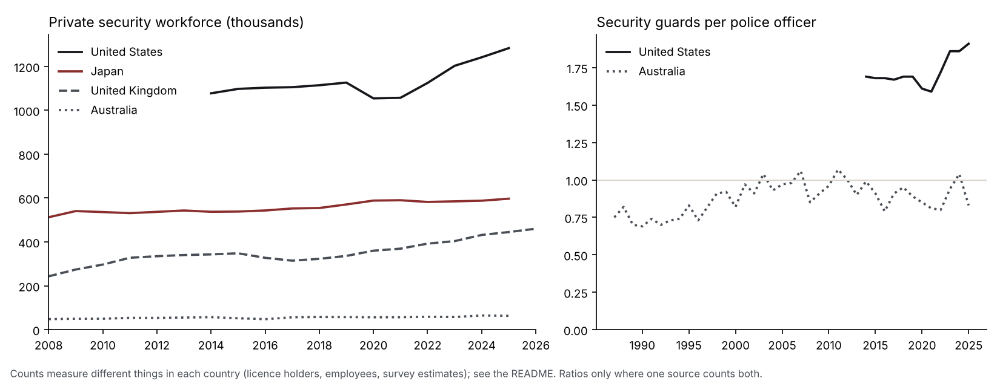

# private-security-workforce

Published by [Mercenomics](https://mercenomics.org), an independent data archive on the business of force for hire.

How many private security guards four countries have, year by year, from each government's own records, and, where the same official source also counts police, how many guards there are for every police officer.

| Country | Private security | Police | Years | Source |
|---|---|---|---|---|
| United States | Security guards employed | Police and sheriff's patrol officers employed | 2014-2025 | Bureau of Labor Statistics |
| Japan | Security guards employed by authorised security companies | not included | 2007-2025 | National Police Agency |
| United Kingdom | People holding an active security licence | not included | 2004-2026 | Security Industry Authority |
| Australia | Security officers and guards employed | Police employed | 1986-2026 | Australian Bureau of Statistics |



## What it shows

- **United States:** 1,283,470 security guards in May 2025 against 670,520 police and sheriff's patrol officers, or **1.91 guards for every police officer**, up from 1.69 in 2014.
- **Japan:** 596,985 security guards at the end of 2025, working for 10,949 authorised security companies.
- **United Kingdom:** 460,138 people held an active Security Industry Authority licence on 1 January 2026, up from 242,985 in January 2008.
- **Australia:** on average 62,800 security officers and guards and 75,300 police were employed in 2025, or **0.83 guards per police officer**. Australia has had roughly as many guards as police since the early 2000s, with the ratio moving between about 0.8 and 1.1.

## Things to know before comparing countries

The four countries count different things, so **compare each country's trend over time, not the size of one country against another.**

- **United States:** an employer survey (Occupational Employment and Wage Statistics). It counts people employed in the occupation in May each year, whether they work for a security company or directly for a shop, hospital or other employer. It does not count the self-employed. The `rse_pct` column gives the survey's own estimate of its sampling error.
- **Japan:** the National Police Agency's count of guards employed by companies authorised under the Security Business Act, at 31 December. It covers every kind of guarding, from traffic guards to cash transport, and both regular and temporary staff (split from 2021).
- **United Kingdom:** the number of people holding at least one active licence from the Security Industry Authority. A licence shows who may legally do licensable security work, not who is working at that moment, and some security roles do not need a licence. One person can hold several licences, so licences outnumber licence holders. The Authority issued its first licences in 2004 (466 licence holders in March 2004), so the rise to about 2008 reflects licensing being taken up, not the workforce growing.
- **Australia:** a household survey (Labour Force Survey), so the quarterly figures move up and down from sampling alone; for example police jump from 64,400 to 84,900 between two November quarters. The annual table averages the four quarters of each year. It counts people by the occupation of their main job.
- **Police** are included only where the same source counts both guards and police (US and Australia), so that both numbers are measured the same way. For Japan and the UK the sources used do not give a matching police headcount.

## The data

| File | Contents |
|---|---|
| [`data/clean/annual_by_country.csv`](data/clean/annual_by_country.csv) | One comparable figure per country and year, with police and guards per police officer where available (92 rows) |
| [`data/clean/security_workforce.csv`](data/clean/security_workforce.csv) | Every figure used, one row per country, period and measure, including UK licences by sector, Japan's regular and temporary guards and company counts, and Australia's quarterly estimates (2,522 rows) |

Columns of `security_workforce.csv`:

| Column | Meaning |
|---|---|
| `country` | Country |
| `period` | Year (`YYYY`), month (`YYYY-MM`) or date (`YYYY-MM-DD`) the figure refers to |
| `period_type` | `year_end`, `month`, `mid_quarter_month` or `date` |
| `workforce` | `private_security` or `police` |
| `measure` | What is counted, for example `guards_employed`, `licence_holders`, `active_licences_door_supervision`, `security_companies` |
| `value` | The figure, exactly as published (Australia: summed across sexes and states) |
| `unit` | `persons`, `thousand persons`, `licences` or `companies` |
| `rse_pct` | United States only: the survey's relative standard error of the estimate, in percent |
| `source` | The agency that published the figure |
| `source_file` | The file in `data/raw/` or the address it came from |
| `source_location` | Where in that file the figure is |

Columns of `annual_by_country.csv`: `country`, `year`, `reference_point` (the date or period behind the figure), `private_security`, `private_security_measure`, `police`, `police_measure`, `guards_per_police_officer`, `note`.

## How the numbers were checked

Run by [`code/03_check.py`](code/03_check.py); results in [`data/clean/check_report.md`](data/clean/check_report.md).

1. **Japan:** twelve years appear in more than one official publication (three police white papers and the 2025 report). Every one agrees. Regular plus temporary guards equals the total in every year they are split.
2. **United States:** for 2016 to 2023 each figure was read twice, from the Bureau's web tables and from its spreadsheets. All 16 match.
3. **Australia:** the figures summed from the Bureau's detailed rows match its own summary table for all 80 November-quarter figures checked.
4. **United Kingdom:** the monthly series has no missing months, and where the Authority's 2021 and 2026 releases overlap they differ by less than 0.1%. The sector columns add up to the total in every month except April 2018, where the source itself differs by one licence; it is kept as published.
5. No figure appears twice, and nothing has been estimated or filled in.

## Reproduce it

Needs Python 3.

```
pip install -r requirements.txt
python code/01_download.py   # UK, Japan and Australia files; prints the US file addresses
python code/02_build.py
python code/03_check.py
python code/04_figure.py
```

The Australian file (56 MB) is not stored in the repository; `01_download.py` fetches it, and `data/raw/australia/eq08_protective_service_extract.csv` keeps the rows used. The US Bureau of Labor Statistics blocks automated downloads, so its figures were read from its official files in a browser and stored in `data/raw/us/` with the address of each file.

## Sources and license

Sources, download dates and terms are in [`data/README.md`](data/README.md). Code: MIT (see [`LICENSE`](LICENSE)). The clean dataset: CC BY 4.0. Source material keeps its own terms: UK figures contain public sector information licensed under the Open Government Licence v3.0; Australian figures are from the Australian Bureau of Statistics under CC BY 4.0; Japanese figures are edited from National Police Agency publications (「警備業の概況」「警察白書」（警察庁）を加工して作成) under the Public Data License 1.0 and are not an official National Police Agency product; US figures are public-domain works of the US government.

## Cite

Azom, Kazi Affnann (2026). *private-security-workforce: official counts of private security guards by country, with police where the same source counts both* (Version v1.0.0) [Data set]. Mercenomics.

See also [`CITATION.cff`](CITATION.cff).
